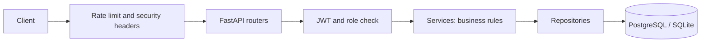

# Telecom REST API Backend

Prepaid plan comparison and recharge backend for a fictional Ahmedabad MVNO.
Built with FastAPI, SQLAlchemy 2.0, JWT, bcrypt, slowapi, pytest, Docker Compose.

## Architecture
`router (HTTP)` -> `service (business rules)` -> `repository (database only)` -> `model (tables)`.
`schemas` validate input/output. Errors are raised as `AppError` subclasses and turned into one JSON shape by a central handler.



## Run locally (Windows PowerShell)
```
python -m venv venv
venv\Scripts\activate
python -m pip install -r requirements.txt
copy .env.example .env      # then put a real SECRET_KEY in .env
python seed.py              # demo data
python -m uvicorn app.main:app --reload
```
Docs: http://127.0.0.1:8000/docs

## Run with Docker (PostgreSQL)
```
docker compose up --build
docker compose exec api python seed.py
```

## Tests
```
python -m pytest --cov=app --cov-report=term-missing --cov-fail-under=75
```

## Roles
| Role | Can do |
|---|---|
| user (customer) | read circles/plans, manage and recharge only their own numbers, file complaints for own numbers |
| staff | everything a customer can on any number, plus create/edit circles, plans, subscribers, usage, recharge/complaint status |
| admin | everything staff can, plus delete plans and manage users |

Demo logins (seed only): admin@example.com / Admin@12345, staff@example.com / Staff@12345, riya@example.com / Riya@12345.

## Main endpoints (about 35)
Auth: `POST /auth/register`, `POST /auth/login`, `GET /auth/me`. Users (admin): `GET/POST /users`, `GET/PATCH /users/{id}`.
Circles, Plans, Subscribers, Recharges, Usage, Complaints: create, list (search, filters, `?page=&page_size=` max 100), get, update, delete or status update.
Extras: `POST /subscribers/{id}/change-plan`, `GET /subscribers/{id}/plan-history`, `GET /usage/summary/{subscriber_id}`, `GET /health`.

Extras: `GET /subscribers/{id}/usage` (total MB, optional date_from/date_to), `POST /admin/subscribers/fix-ported-out` (admin only: clears the plan of ported-out numbers and fails their pending recharges).

## Messy data handled
- **Ported-out but active-looking:** a `ported_out` number may still have a plan, recent recharges and usage. It cannot be recharged, change plan or be reactivated.
- **Duplicate complaints:** server builds `dedupe_key = subscriber|category|date`; the later app/call-centre copy keeps `linked_to_id` pointing to the original. Nothing is deleted.
- **Mixed MB/GB usage:** `raw_value` and `unit` are stored as sent, `data_mb` is converted (1 GB = 1024 MB) so totals are fair.

## OWASP API Top 10 (2023) mapping
| Risk | What this project does |
|---|---|
| API1 Broken object level authorization | customers only see their own rows; others get 404 |
| API2 Broken authentication | bcrypt, short-lived JWT, same error for wrong email/password, login limited to 5/minute |
| API3 Property level authorization | create schemas have no role/status/amount/data_mb; responses never include password hashes |
| API4 Unrestricted resource consumption | page_size max 100, 1 MB body limit, rate limits |
| API5 Broken function level authorization | role checks on every route; role read from the database each request |
| API6 Sensitive business flows | recharge price comes from the plan, only staff mark payments, finished payments are locked |
| API8 Security misconfiguration | security headers, CORS allow-list, no stack traces in errors, secrets only in `.env` |
| API9 Improper inventory management | OpenAPI docs at `/docs`, one router per resource |

## Known limitations
Rate limit counters are in memory (one process). The body-size check uses the Content-Length header. No refresh tokens or email verification. Demo passwords are for seed data only.